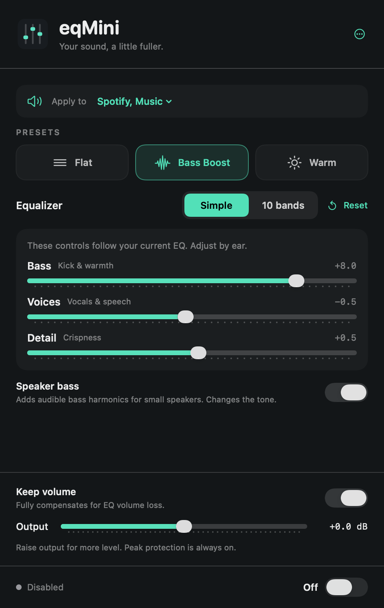
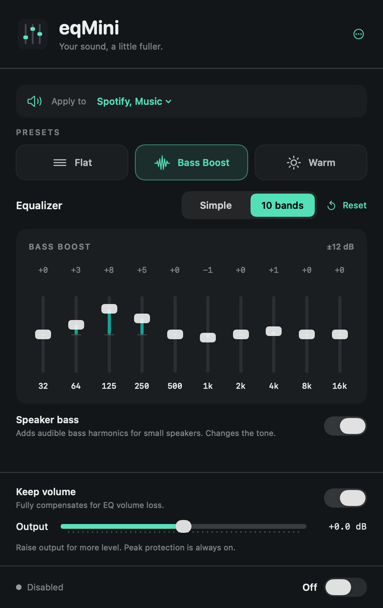
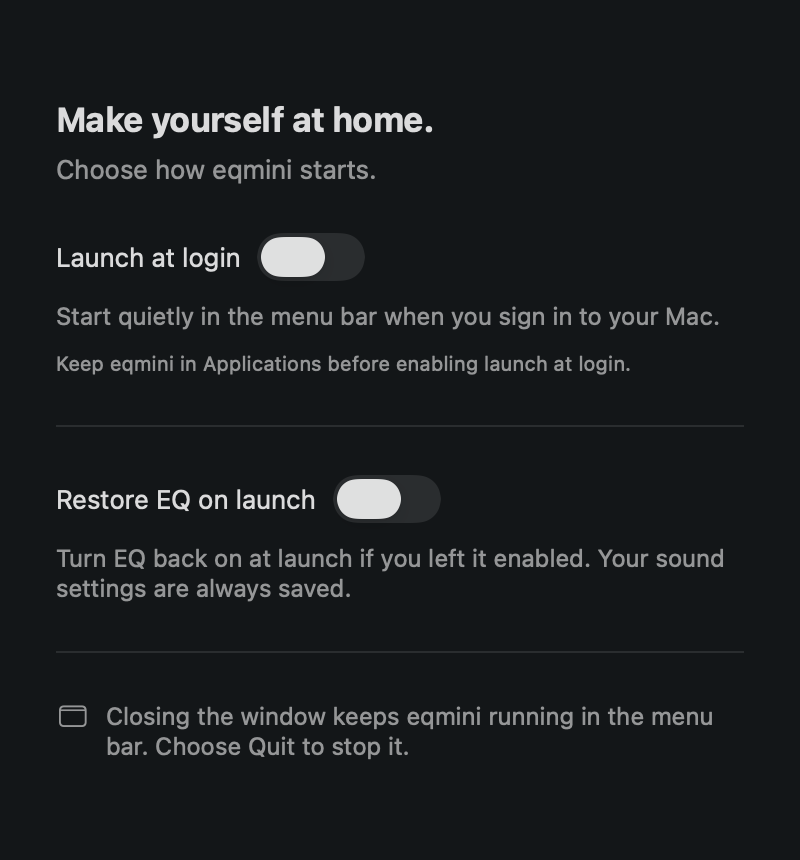

# eqmini

A small equalizer for macOS. Shape all audio or just the apps you choose.

SwiftUI interface, ten-band EQ, and a bass enhancer for small speakers. No virtual audio driver, account, analytics, or audio uploads. MIT licensed.



## Install

Requires **macOS 14.2 or later**. The first downloadable preview is for **Apple silicon**.

1. Download the ZIP or DMG from [Releases](https://github.com/elmsec/eqmini/releases).
2. Drag **eqmini.app** into **Applications** and open it.
3. Enable the equalizer. Allow system audio recording when macOS asks.

**Preview 2 is Developer ID signed and notarized by Apple.** Both the app and DMG include stapled notarization tickets and pass Gatekeeper assessment. System audio permission is still required. See [distribution status](DISTRIBUTION.md).

## Use it

- Pick **Flat**, **Bass Boost**, or **Warm**. Your saved **Custom** curve stays available separately.
- In **Simple**, adjust **Bass**, **Voices**, and **Detail** by ear. **10 bands** exposes the individual frequencies. Switching views preserves the sound.
- Use **Speaker bass** for extra audible bass harmonics on small speakers. Bass Boost enables it. Try turning it off on headphones.
- **Keep volume** compensates for EQ headroom attenuation. **Output** adds independent gain. Peak protection stays on; large boosts can cause compression.
- Choose **All audio** or **Selected apps** under **Apply to**. The selected apps share one curve. Other apps keep their ordinary audio path. An empty selection never falls back to all audio.
- **Reset** clears the EQ, saved Custom curve, and Speaker bass. It preserves routing, output gain, and the enable state. Double-click a band to reset only that band.

Small speakers cannot reproduce physical sub-bass. Speaker bass changes the tone by adding upper harmonics; it does not extend the speaker's hardware limits. Start at a comfortable playback level.

Open **More → Open Equalizer Window** for a regular window with native macOS menus. Closing windows leaves the app running in the menu bar. **Quit** stops processing and releases the audio route.

**Settings…** (⌘,) contains **Launch at login** and **Restore EQ on launch**, both off by default. Login launches stay quietly in the menu bar. Install the app in Applications before enabling startup. If macOS needs approval, Settings shows a link to the appropriate system panel.

| Shortcut | Action |
| --- | --- |
| ⌘O | Open the equalizer window |
| ⌘1 / ⌘2 | Simple / 10 bands |
| ⌘E | Enable or bypass |
| ⌘, | Settings |
| ⌘W / ⌘Q | Close window / quit app |

<details>
<summary>10-band view and Settings</summary>




</details>

## Permissions and privacy

macOS requires **System Audio Recording** access to process other apps' sound. eqmini explains why before the first enable; only **Continue** proceeds to audio setup and macOS's permission request. **Not Now** leaves the equalizer bypassed. The setting can appear under **Screen & System Audio Recording**, depending on macOS. eqmini uses an audio-only Core Audio tap. It does not capture screen images, record audio files, or upload audio.

If access was denied, enable it in **System Settings → Privacy & Security**, then quit and reopen eqmini. Audio permission and downloaded-app verification are separate checks.

Settings and app selections stay in local macOS preferences. There is no automatic telemetry, update checker, or network service in the app. Website links open your browser. Read the [privacy policy](https://elma.dev/eqmini/privacy) and [terms](https://elma.dev/eqmini/terms).

## Build

Requires Xcode's macOS SDK and command-line tools. No third-party runtime dependencies or package installation.

```sh
git clone https://github.com/elmsec/eqmini.git
cd eqmini
bash scripts/build.sh
open build/eqmini.app
```

The script builds for the current architecture and ad-hoc signs the app. Quit the running app before rebuilding. To cross-compile, use `ARCH=arm64` or `ARCH=x86_64`; a successful cross-build is not hardware validation. The current release is Apple silicon only.

```sh
bash scripts/test.sh             # DSP and isolated settings/startup tests
SANITIZE=1 bash scripts/test.sh  # DSP with AddressSanitizer and UBSan
```

CI builds and runs these tests on Apple silicon and Intel macOS runners. Tests do not change login items, use the user's saved EQ, or request audio capture. Live audio tests are separate and opt-in; see [testing](docs/TESTING.md).

## How it works

The app creates a private Core Audio process tap and a private aggregate device connected to the current default output. Selected-app mode uses an inclusive list of process IDs. It does not install a driver or change the default audio device.

Audio setup and teardown run on a serial control queue. The render callback uses preallocated filter state and atomic parameter targets, with no locks, allocation, file access, logging, or Objective-C calls. The DSP contains ten peaking biquads, response-based headroom, smoothed parameters, an optional parallel bass-harmonic path, and a linked stereo sample-peak limiter.

[Architecture](docs/ARCHITECTURE.md) · [Contributing](CONTRIBUTING.md) · [Security](SECURITY.md) · [Release process](DISTRIBUTION.md)

## Limits

- Processes the current default output's first mono/stereo stream. Apps explicitly routed to another device are outside that route.
- Shared system audio services and protected playback may prevent per-app selection or capture.
- Surround and multi-output setups are unsupported. Bluetooth transitions and sleep/wake recovery need broader hardware testing.
- Peak protection limits digital samples; it is not a true-peak limiter or a hearing/speaker protection guarantee.
- Login registration and downloaded installation need validation on a clean Mac. Automated tests cannot establish perceived sound quality.

## License and credits

[MIT](LICENSE), © 2026 Can Elma. Built with Apple's public frameworks.

If eqmini is useful to you, you can support it through [GitHub Sponsors](https://github.com/sponsors/elmsec) or [Buy Me a Coffee](https://www.buymeacoffee.com/canelma). Donations are optional and do not unlock features.
