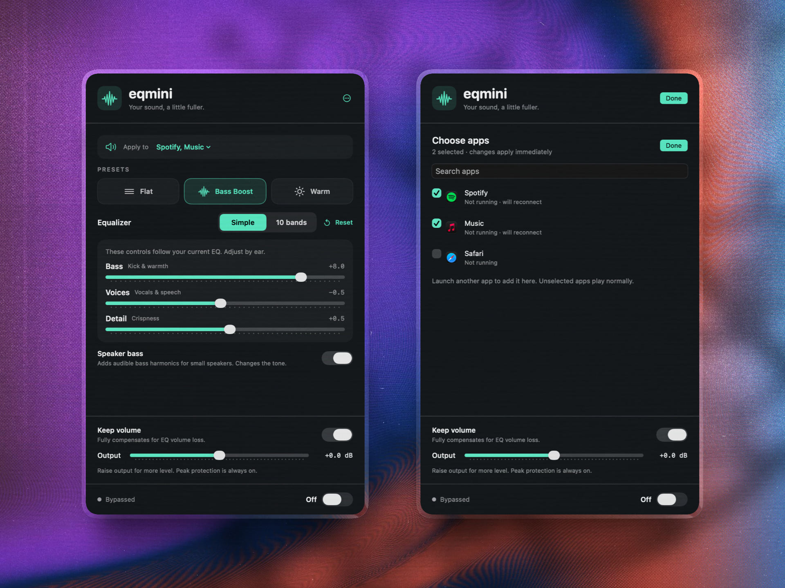

# eqMini

A small equalizer for macOS. Shape all audio or just the apps you choose.

Ten-band EQ, simple tone controls, and a bass enhancer for small speakers. No virtual audio driver, account, analytics, or audio uploads. MIT licensed.



## Install

Requires **macOS 14.2+** and **Apple silicon**.

1. Download the DMG or ZIP from [Releases](https://github.com/elmsec/eqmini/releases).
2. Drag **eqMini.app** into **Applications** and open it.
3. Enable the equalizer and allow **System Audio Recording** when macOS asks.

**Downloads are Developer ID signed and notarized by Apple.** The app and DMG include stapled tickets and pass Gatekeeper assessment.

## Use

- Choose **Flat**, **Bass Boost**, **Warm**, or your saved **Custom** curve.
- Adjust **Bass**, **Voices**, and **Detail** in **Simple**, or switch to **10 bands**. Switching views preserves the sound.
- **Speaker bass** adds audible bass harmonics for small speakers. **Keep volume** compensates for EQ headroom; **Output** adds gain. Large boosts can cause compression.
- Choose **All audio** or **Selected apps**. Selected apps share one curve; other apps keep their normal sound.
- **Reset** clears the EQ, Custom curve, and Speaker bass. Double-click a band to reset it individually.

The first normal launch opens a welcome window; later startups stay in the menu bar. Use **More → Open Equalizer Window** for a regular window. Left-click the menu-bar icon for the panel; right-click for quick actions. Closing the window leaves eqMini in the menu bar; quitting stops processing. **Settings…** contains optional **Launch at login** and **Restore EQ on launch**, both off by default.

Shortcuts: **⌘O** open window · **⌘1 / ⌘2** Simple / 10 bands · **⌘E** enable / disable · **⌘,** Settings · **⌘Q** quit.

<details>
<summary>10-band view and Settings</summary>


</details>

## Privacy

System Audio Recording permission is required to process other apps' sound. eqMini explains this before the first enable after an update, including when enabled from a menu. Its Core Audio tap captures audio only: no screen images, saved recordings, or uploads. If access was denied, allow it in **System Settings → Privacy & Security**, then reopen eqMini.

Preferences stay on your Mac. The app makes no network requests; website links open your browser. [Privacy policy](https://elma.dev/eqmini/privacy) · [Terms](https://elma.dev/eqmini/terms).

## Build

Requires Xcode's macOS SDK and command-line tools. No third-party runtime dependencies.

```sh
git clone https://github.com/elmsec/eqmini.git
cd eqmini
bash scripts/build.sh
open build/eqMini.app
```

Local builds are ad-hoc signed. Use `ARCH=arm64` or `ARCH=x86_64` to choose an architecture. CI builds and tests on both; downloadable releases currently target Apple silicon.

```sh
bash scripts/test.sh
SANITIZE=1 bash scripts/test.sh  # DSP with AddressSanitizer and UBSan
```

Tests use isolated preferences and do not request audio access or change login items.

## Limits

eqMini processes the default output's first mono/stereo stream. Surround and multi-output setups are unsupported. Protected playback and shared audio services may limit per-app capture.

Small speakers cannot reproduce physical sub-bass; Speaker bass adds harmonics instead. Peak protection is a sample limiter, not a hearing or speaker protection guarantee.

[Architecture](docs/ARCHITECTURE.md) · [Testing](docs/TESTING.md) · [Contributing](CONTRIBUTING.md) · [Security](SECURITY.md) · [Distribution](DISTRIBUTION.md)

## Support and license

[MIT](LICENSE), © 2026 Can Elma. Built with Apple's public frameworks.

Optional support: [GitHub Sponsors](https://github.com/sponsors/elmsec) · [Buy Me a Coffee](https://www.buymeacoffee.com/canelma). Donations do not unlock features.
